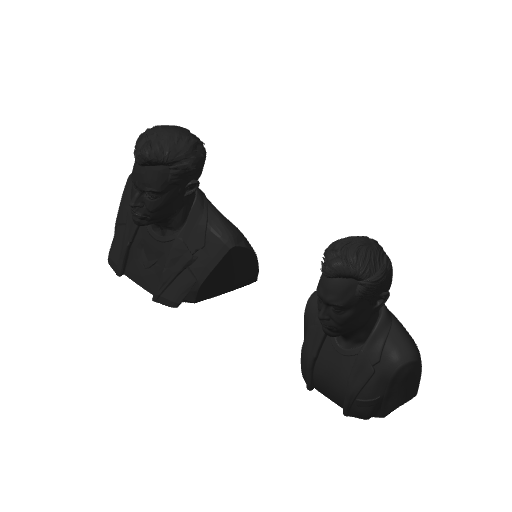

# Some 3D Models (3D 打印模型库)

个人 3D 打印模型与切片工程整理仓库，用于归档、备份和多设备同步各类 3D 打印模型（支持 `.3mf`、`.stl`、`.step` 等格式）。

---

## 📂 模型目录索引

| 模型名称 | 文件格式 | 推荐机型 / 喷嘴 | 耗材 & 用量 | 层高 | 支撑 | 预计耗时 | 预览 |
| :--- | :--- | :--- | :--- | :--- | :--- | :--- | :---: |
| [Elon Musk (埃隆·马斯克半身摆件)](#elon-musk-埃隆马斯克半身摆件) | `.3mf` (含切片/G-code) | Bambu Lab P2S / 0.4mm | PLA / 约 32.8g | 0.20mm | 开启 | 约 1h 13m | [查看](#elon-musk-埃隆马斯克半身摆件) |

---

## 🛠 模型详情

### Elon Musk (埃隆·马斯克半身摆件)

- **文件路径**：[`models/elonmusk/elonmusk.gcode.3mf`](models/elonmusk/elonmusk.gcode.3mf)
- **切片工具**：Bambu Studio / OrcaSlicer
- **推荐机型**：Bambu Lab P2S / X1 / P1 系列（0.4mm 喷嘴，其他机型可在切片软件中重新适配）
- **打印配置**：
  - **耗材类型**：PLA（黑色或任意颜色）
  - **耗材用量**：约 32.76 克（10.81 米）
  - **打印层高**：0.20mm Standard
  - **热床类型**：Textured PEI Plate（纹理 PEI 热床）
  - **支撑配置**：开启支撑（Support Enabled）
  - **预估耗时**：约 1 小时 13 分钟

#### 模型预览
<p align="center">
  
</p>

---

## 📁 仓库结构规范

为了便于后续扩充新模型，建议遵循如下分类目录结构：

```text
some-3d-models/
├── models/                     # 模型总目录
│   └── elonmusk/               # 具体模型文件夹（建议英文/拼音命名）
│       ├── elonmusk.gcode.3mf  # 3D 模型工程/切片文件
│       └── preview.png         # 模型渲染或实拍预览图
├── .gitignore                  # Git 忽略文件配置
└── README.md                   # 仓库主说明文档及索引
```

---

## 🚀 后续添加新模型步骤

后续需要上传其他 3D 模型时，可按以下标准步骤操作：

1. **新建模型目录**：
   在 `models/` 目录下创建一个新的文件夹（如 `models/<模型名称>/`）。

2. **放入模型及预览图**：
   - 将 `.3mf`、`.stl` 或 `.step` 文件放入该文件夹。
   - 提取或截图一张预览图保存为 `preview.png`（便于在网页中直观查看）。

3. **更新 README.md**：
   在上方表格中追加一行该模型的简要信息与预览。

4. **推送提交到 Gitee**：
   ```bash
   git add .
   git commit -m "feat: 添加新模型 <模型名称>"
   git push origin master
   ```
